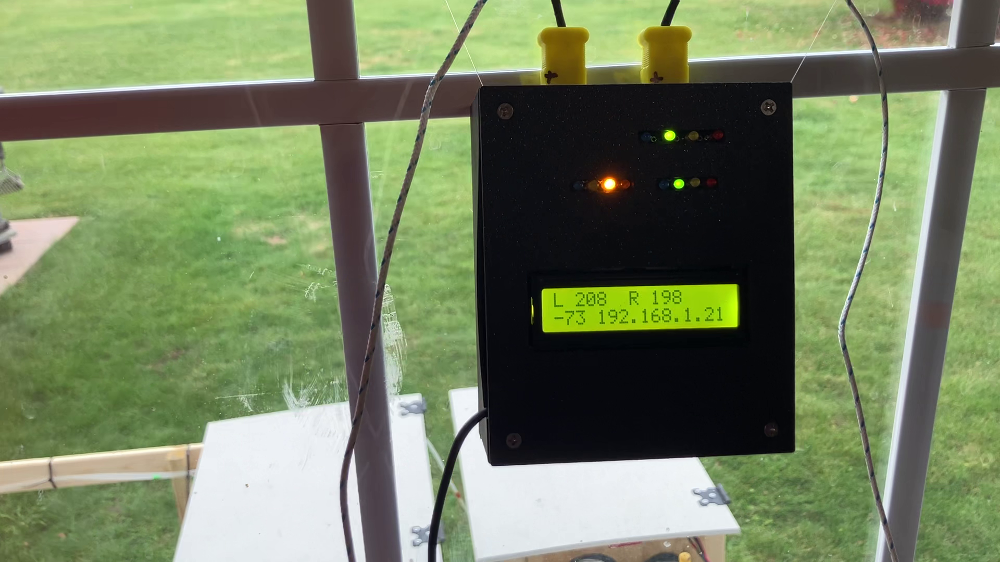

# Thermal Probe Alerter

Hardware and firmware for a two type K (high temp) thermal probe monitor that alerts on conditions such as overheating, with visual (LED's and LCD Display), auditory (future), and internet (email) alerts.

*Pictures show the hw-1.0 hardware.*

Each hardware generation is a separate, self-contained project with its own code, documentation, and license files. The projects share no files or directories between hardware versions.

| Directory | Hardware | Platform | Status |
| :--- | :--- | :--- | :--- |
| [`hw-1.0-pico-python/`](hw-1.0-pico-python/) | v1.0: two Type K probes, 12 LEDs, 16x2 LCD | Raspberry Pi Pico W, MicroPython | Working |
| [`hw-2.0-pico-c/`](hw-2.0-pico-c/) | v2.0 | Raspberry Pi Pico, C/C++ SDK | Planned |

See the README in each directory for details, setup, and the safety disclaimer.

## Getting started with hw-1.0

`hw-1.0-pico-python/Python_Code_Place_On_Pico/main.py` ships with room-temperature **test** thresholds. Hold a probe between your fingers to reach the "high" range and trigger the red LED and an email alert, which verifies the whole setup. Then set your own operating values: the right thresholds depend on what you are measuring and when you want to be alerted. All temperatures are in degrees Fahrenheit. See [`hw-1.0-pico-python/README.txt`](hw-1.0-pico-python/README.txt) for full setup notes.

## Disclaimer

This is a personal hobby project, provided "as is" without warranty of any kind. Use it at your own risk. It is NOT designed, tested, or certified for life-safety or other critical uses. See each project's README for the full disclaimer.

## License

Copyright (C) 2026 Virgil Mehalek

Licensed under the GNU General Public License v3.0 or later. See [LICENSE](LICENSE). Third-party libraries included in individual projects keep their own licenses, listed in that project's `THIRD_PARTY_LICENSES.txt`.
