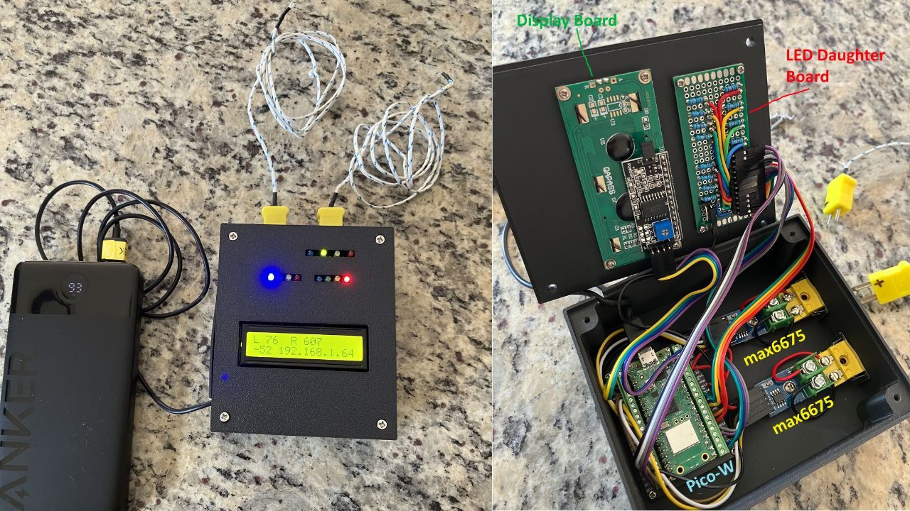

# Thermal Probe Alerter

A small, do-it-yourself temperature monitor that tells you when something is too hot or too cold, even when you're not home.

- **What it watches:** diesel heaters, stoves, ovens, fridges, and freezers
- **How it tells you:** colored lights, a buzzer, a small screen, and an email to your phone
- **What it's built from:** a Raspberry Pi Pico W, temperature probes, and open-source code

*Top: hw-1.0 hardware. Bottom: hw-2.0 breadboard prototype.*

Each hardware generation is a separate, self-contained project with its own code, documentation, and license files. The projects share no files or directories between hardware versions.

| Directory | Hardware | Platform | Status |
| :--- | :--- | :--- | :--- |
| [`hw-1.0-pico-python/`](hw-1.0-pico-python/) | v1.0: two Type K probes, 12 LEDs, 16x2 LCD | Raspberry Pi Pico W, MicroPython | Working |
| [`hw-2.0-pico-python-MAXI/`](hw-2.0-pico-python-MAXI/) | v2.0: four Type K probes, DS18B20 probes, buzzer, 13 LEDs, 20x4 LCD | Raspberry Pi Pico W, MicroPython | Alpha, on hold (breadboard only) |
| [`hw-3.0-pico-c-MINI/`](hw-3.0-pico-c-MINI/) | v3.0 MINI: one Type K and/or DS18B20 probe, buzzer, one unit per appliance | Raspberry Pi Pico W, C/C++ SDK | Planned |

See the README in each directory for details, setup, and the safety disclaimer.

## Disclaimer

This is a personal hobby project, provided "as is" without warranty of any kind. Use it at your own risk. It is NOT designed, tested, or certified for life-safety or other critical uses. See each project's README for the full disclaimer.

## License

Copyright (C) 2026 Virgil Mehalek

Licensed under the GNU General Public License v3.0 or later. See [LICENSE](LICENSE). Third-party libraries included in individual projects keep their own licenses, listed in that project's `THIRD_PARTY_LICENSES.txt`.
