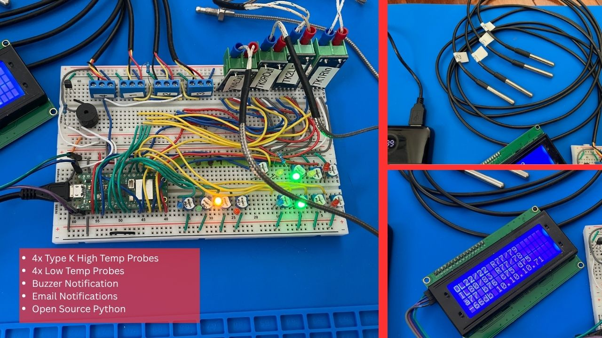

# TempAlerter Type K x4 - MAXI - ALPHA

Hardware v2.0: four Type K probes, DS18B20 low-temp probes, a buzzer, 13 LEDs,
and a 20x4 LCD display. It builds on hardware v1.0 (see
[`../hw-1.0-pico-python/`](../hw-1.0-pico-python/)) but is a separate product
with its own code.

## What it does

TempAlerter is a four-channel high-temperature monitor and alarm built on a
Raspberry Pi Pico W running MicroPython.

- Reads four Type K thermocouples through MAX6675 boards on a shared bus
  (TK1 Right In, TK2 Left In, TK3 Right Out, TK4 Left Out), in degrees F,
  with a per-probe calibration offset.
- Reads DS18B20 low-temp probes on a 1-Wire bus (TempLow1-4), with per-probe
  calibration offsets.
- Sorts each Type K reading into one of four ranges (under / low / med /
  high). TK1 drives the right-side LEDs and TK2 the left-side LEDs (Blue,
  Green, Yellow, Red). TK3 drives the top-right Yellow and Red LEDs. The top-left Red and Yellow
  LEDs are wired but not used by the code yet.
- Tracks the maximum temperature for each Type K probe over a rolling window
  (`MAX_TEMP_WINDOW`, default 20 minutes), and holds the peak of any
  over-temperature event for the same window.
- Sounds the buzzer for TK1 and TK2: a short beep on Green to Yellow, a
  shorter beep on Yellow to Green, and three beeps on every update while in
  the "high" range.
- Shows outer probes (actual/max), inner probes (actual/max), the low-temp
  probes, and WiFi signal strength with the IP address on the 20x4 LCD.
- Connects to WiFi at startup. The top green LED stays lit (with a quick
  flicker each update) while WiFi is up.
- Sends an email alert through Gmail (SMTP over SSL) when any Type K probe
  reaches the "high" range, if `EMAIL_ENABLED` is True. While it stays high,
  the alert repeats at most once every `resend_email_interval` seconds
  (default 120).
- Optional: a watchdog timer (`WATCHDOG_ENABLED`) and a WiFi keepalive ping
  to the gateway (`KEEPALIVE_ENABLED`) to help with mesh-network roaming.

## Setup notes

- WiFi, email, and SMTP settings go in `config.py` (use a Gmail app
  password). Keep real values out of anything you share.
- `main.py` ships with email **off** (`EMAIL_ENABLED = False`) and with
  room-temperature **test** thresholds (`under_val`, `low_val`, `high_val`
  near the top of the file). Hold a probe between your fingers to reach the
  "high" range and trigger the red LED and buzzer. Once setup is verified,
  set your own operating values and turn email on.
- The right thresholds depend on what you are measuring and when you want to
  be alerted. The commented-out values in `main.py` are examples only. All
  temperatures are in degrees Fahrenheit.
- The LCD code expects four DS18B20 probes to be connected.
- Upload all files in `Python_Code_Place_On_Pico/` to the root of the Pico W
  (e.g. with Thonny). `main.py` runs automatically at power-up.
- `Test_Code/` holds standalone test scripts (LED chase and buzzer, DS18B20
  probes, WiFi ping, system check). They are not needed on the Pico.

Wiring and pin assignments are documented in `CLAUDE.md`,
`schematic-hw2.0.jpg`, and `parts_list.txt`.

## License

Copyright (C) 2026 Virgil Mehalek

TempAlerter is free software, licensed under the GNU General Public License
v3.0 or later. See the [LICENSE](LICENSE) file for the full text.

## Credits

These third-party libraries in `Python_Code_Place_On_Pico/` are used under the
MIT License. Full license notices are in
[THIRD_PARTY_LICENSES.txt](THIRD_PARTY_LICENSES.txt).

| File | Author | Source |
| :--- | :--- | :--- |
| `lcd_api.py` | Dave Hylands | https://github.com/dhylands/python_lcd |
| `lcd_pico_i2c.py` | Tyler Peppy (based on Dave Hylands' python_lcd) | https://github.com/T-622/RPI-PICO-I2C-LCD |
| `max6675.py` | Ivan Sevcik (modified for a shared bus) | https://github.com/BetaRavener/micropython-hw-lib |
| `umail.py` | Shawwwn | https://github.com/shawwwn/uMail |
| `wifi_ping.py` | Wataru KUNINO (adapted) | https://github.com/bokunimowakaru/ping |

## Disclaimer

This is a personal hobby project, provided "as is" without warranty of any
kind. Use it at your own risk.

It is NOT designed, tested, or certified for life-safety, fire-protection,
medical, or other critical uses, and must not be relied on to protect people,
animals, or property. Temperature readings may be inaccurate, and alerts
(LEDs, buzzer, display, and email) can be delayed or fail entirely because of
sensor, wiring, WiFi, power, or software faults.

Always use properly certified safety devices (smoke and CO detectors, thermal
cutoffs, etc.) for anything that matters. The author accepts no liability for
any damage, injury, or loss resulting from use of this code or hardware
design.
